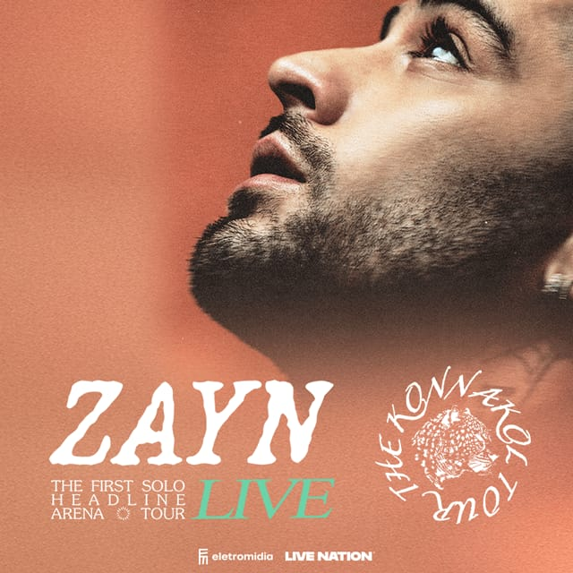

<!DOCTYPE html>
<html lang="pt-BR">
<head>
    <meta charset="UTF-8">
    <meta name="viewport" content="width=device-width, initial-scale=1.0, maximum-scale=1.0, user-scalable=no">
    <title>Trabalho Faculdade</title>
    
    <link href="https://fonts.googleapis.com/icon?family=Material+Icons" rel="stylesheet">
    
</head>
<body>

    

        
        <!-- ==========================================
             TELA 1: EXPLORE (Meus Ingressos)
             ========================================== -->
        

            <header class="flex justify-between items-center px-5 pt-8 pb-4">
                <h1 class="text-[26px] font-extrabold tracking-tight">Meus ingressos</h1>
                

                    notifications_none
                    person_outline
                

            </header>

            

                

                    <button class="flex-1 py-2 text-[15px] font-semibold bg-white text-black rounded-lg shadow-sm">Próximos</button>
                    <button class="flex-1 py-2 text-[15px] font-semibold text-gray-400">Anterior</button>
                

            

            

                <!-- Cartão Clicável -->
                

                    

                        <!-- Imagem da formatura -->
                        
                        

                            AGORA
                        

                    

                    

                        

                            2 ingressos
                            Sábado 10 20:00hs
                        

                        <h3 class="text-white text-[18px] font-bold leading-tight mb-1">ZAYN: The Konnakol Tour - São Paulo</h3>
                        
Nubank Parque

                    

                

            

        

        <!-- ==========================================
             TELA 2: PERFIL
             ========================================== -->
        

            <header class="flex justify-between items-center px-5 pt-8 pb-4 border-b border-gray-800">
                <h1 class="text-[26px] font-extrabold tracking-tight">Meu Perfil</h1>
                settings
            </header>

            

                

                    
                

                
                <h2 class="text-white text-[22px] font-bold mb-1">Stefanne Fonseca</h2>
                
stefanne.fonseca94@gmail.com

                

                    <button class="w-full flex items-center justify-between p-4 border-b border-gray-800 hover:bg-gray-800 transition-colors">
                        

                            account_circle
                            Dados Pessoais
                        

                        chevron_right
                    </button>
                    <button class="w-full flex items-center justify-between p-4 hover:bg-gray-800 transition-colors">
                        

                            logout
                            Sair da conta
                        

                    </button>
                

            

        

        <!-- ==========================================
             MENU INFERIOR FIXO
             ========================================== -->
        <nav class="absolute bottom-0 w-full bg-white border-t border-gray-200 flex justify-around items-center h-[65px] z-20">
            <a href="#" onclick="mudarTela('explore', this)" class="nav-btn flex flex-col items-center text-yellow-500 w-full py-2">
                home
                Explore
            </a>
            <a href="#" class="nav-btn flex flex-col items-center text-gray-400 w-full py-2">
                search
                Buscar
            </a>
            <a href="#" class="nav-btn flex flex-col items-center text-gray-400 w-full py-2">
                confirmation_number
                Meus Eventos
            </a>
            <a href="#" onclick="mudarTela('perfil', this)" class="nav-btn flex flex-col items-center text-gray-400 hover:text-gray-900 transition-colors w-full py-2">
                person
                Perfil
            </a>
        </nav>

        <!-- ==========================================
             TELA 3: INGRESSO ABERTO (SOBREPOSIÇÃO)
             ========================================== -->
        

            <header class="sticky top-0 z-20 bg-[#121212]/95 backdrop-blur-sm px-4 pt-12 pb-3 flex items-center justify-between border-b border-gray-800">
                <button onclick="fecharTicket()" class="p-2 -ml-2 text-gray-300 hover:text-white transition-colors">
                    arrow_back_ios_new
                </button>
                

                    <h2 class="text-white text-sm font-bold truncate">ZAYN: The Konnakol Tour - São Paulo</h2>
                    
10/10/26 - Nubank Parque

                

                <button class="p-2 -mr-2 text-gray-300 hover:text-white">
                    ios_share
                </button>
            </header>

            

                

                    

                        

    

                        <!-- BARRA DE CARREGAMENTO ANIMADA -->
                        

                            

                        

                        

                           

    

                            

                                

                                    
SETOR

                                    
Pista Premium

                                

                                

                                    
ACESSO

                                    
Portão B

                                

                                <button class="bg-[#e2e8f0] text-gray-700 text-xs font-semibold py-1.5 px-3 rounded-lg w-full mt-1">
                                    Mais informação
                                </button>
                            

                        

                        

                        

                            

                                
TAXA

                                
Inteira - R$ 890

                            

                            

                                

                                    
SEÇÃO

                                    
PISTA PREMIUM

                                

                                

                                    
FILEIRA

                                    
Não numerado

                                

                            

                            

                                

                                    
ABERTURA

                                    
16:00

                                

                                

                                    
INÍCIO

                                    
20:00

                                

                            

                        

                    

                

            

        

    

    
</body>
</html>

